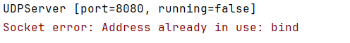
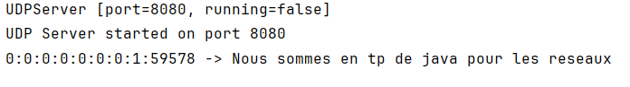
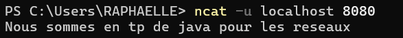
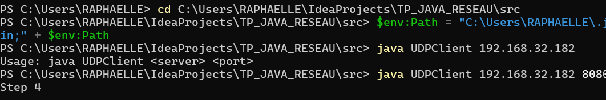
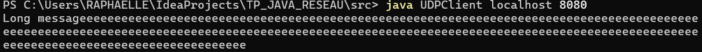
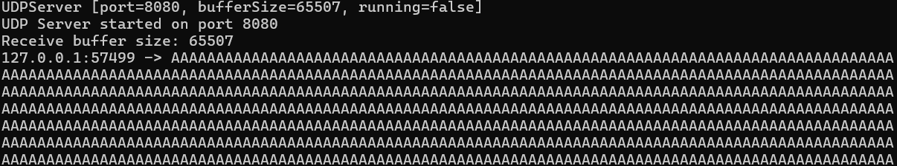

# TP_Java_Reseaux
Report on the Network Java lab

## UDP SERVER
**Step 1**
The objective of this step is to create a UDP server in Java that receives datagrams from clients.

The server listens on a specified port and displays each received message along with the client's IP address and port number.

The project contains one Java classes: UDPServer.java

The UDPServer.java class implements the UDP server. It contains 2 constructors etc 

The default port is 8080. 

PowerShell is the "client" 

We can notice we can connect

**Step 2**
We are using the ncat programm in an other powershell 

We can see that the 2 servers are trying to use the same port (8080) at the same time but it is already being used by the first one 

Therefore we close the first powershell and run again and we get :

## UDP Client

**Step 3**

So for this step we have one powershell that is the server and an other powershell that is the client

The client takes 2 command arguments : the server address (localhost) and the server port (8080)

**Step 4**

We tested the UDP communication between two computers connected to the same network.

One computer acted as the UDP server and listened on port 8080. The second computer acted as the UDP client and sent messages to the server using its IPv4 address.

**Step 5**

We verify that the 3 lengh buffer can work

We have 2 powershell

We write a very long text and we choose a buffer of 64 octets (the smaller one)

we can notice that the text is shorten because the length of the buffer is way lower than the length of the text. 

As we can see, the client is not informe of the cut and the rest of the text disappeared 

**Step 6**
Compare to the step 5, we take the largest buffer now
We created a test program called UDPTest to send UDP datagrams of increasing sizes to the server, which was started with a receive buffer of 65,507 bytes.

The tested datagram sizes were 1,000, 10,000, 65,507 and 65,508 bytes
The first 3 datagrams were successfully sent but for the 65,508 bytes datagram, the operation failed with the error saying the message was larger than the maximum supported size. 

