# TP_Java_Reseaux
Report on the Network Java lab

## UDP SERVER
**Step 1**
The objective of this step is to create a UDP server in Java that receives datagrams from clients.

The server listens on a specified port and displays each received message along with the client's IP address and port number.

The project contains one Java classes: UDPServer.java

The UDPServer.java class implements the UDP server. It contains 2 constructors etc 

The default port is 8080. 

PowerShell is the "client" 

We can notice we can connect

**Step 2**
We are using the ncat programm in an other powershell 

We can see that the 2 servers are trying to use the same port (8080) at the same time but it is already being used by the first one 

Therefore we close the first powershell and run again and we get :

## UDP Client

**Step 3**

So for this step we have one powershell that is the server and an other powershell that is the client

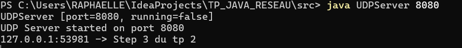

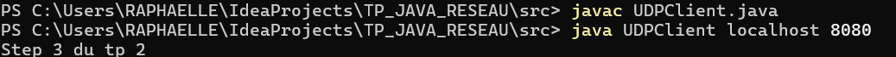

The client takes 2 command arguments : the server address (localhost) and the server port (8080)

**Step 4**

We tested the UDP communication between two computers connected to the same network.

One computer acted as the UDP server and listened on port 8080. The second computer acted as the UDP client and sent messages to the server using its IPv4 address.

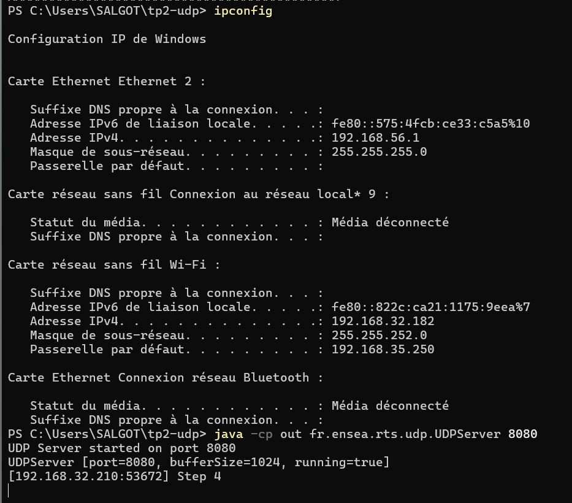

**Step 5**

We verify that the 3 lengh buffer can work

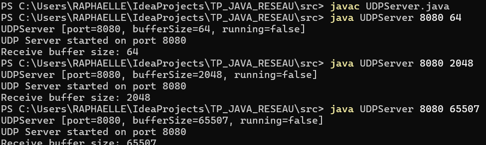

We have 2 powershell

We write a very long text and we choose a buffer of 64 octets (the smaller one)
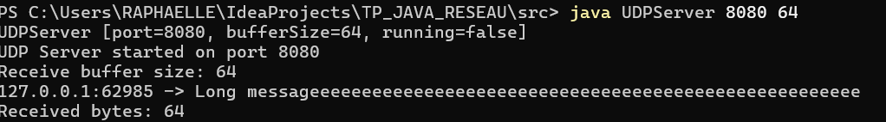

we can notice that the text is shorten because the length of the buffer is way lower than the length of the text. 

As we can see, the client is not informe of the cut and the rest of the text disappeared 

**Step 6**
Compare to the step 5, we take the largest buffer now
We created a test program called UDPTest to send UDP datagrams of increasing sizes to the server, which was started with a receive buffer of 65,507 bytes.

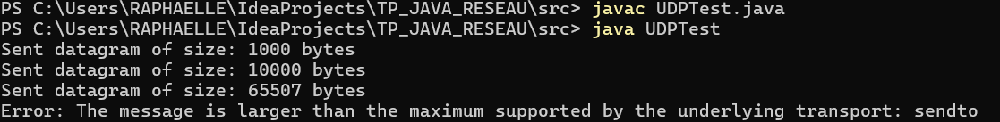

The tested datagram sizes were 1,000, 10,000, 65,507 and 65,508 bytes
The first 3 datagrams were successfully sent but for the 65,508 bytes datagram, the operation failed with the error saying the message was larger than the maximum supported size. 

**Step 7**

Here is the wireshark capture for localhost between 2 powershell (server and client) with protocol : UDP and with the port = 8080
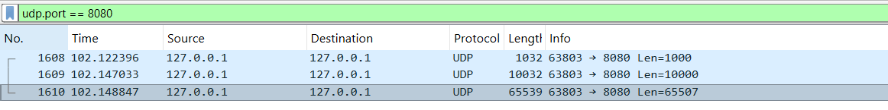

In the Java programm, we change the int sizes int[] sizes = {10, 10000};

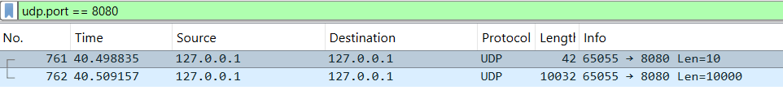

We sent two datagrams from the client to the server : a small datagram containing 10 bytes and a large datagram containing 10,000 bytes.

On the localhost interface, we have one IP packet for each datagram including the 10,000-byte datagram. This is because the loopback interface does not behave like a standard Ethernet network with an MTU of 1,500 bytes.

**Step 8**
a) The receive buffer is chosen by the receiver because it is the server that decides how much memory it wants to allocate to store incoming datagrams.
The sender does not know the receiver's available memory or buffer size. If a datagram is larger than the receiver's buffer, the received data may be damage.

b)Sending datagrams larger than about 1,400 bytes is not recommended because they may need to be fragmented into several IP packets to travel across the network because of MTU

## Connectionless communication

**Step 9**
a)
So here we send a message from the client to the server before starting the server
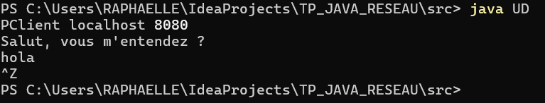
The server doesn't reveice any message even when we stop sending messages to the server and starting it. 

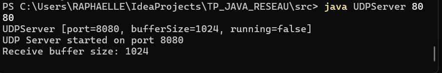

b) we send messages to several different ports, on which no server is listening. In Wireshark, we can see ICMP Destination Unreachable messages, specifically Port Unreachable messages. It means that the UDP datagram reaches a computer but there is no application listening on the destinbation port, so the computer can send an ICMP error message to inform the sender that the port is unreachable 

c)

We started and stopped the UDP client twice
the IP address remains the same but the source port changed, therefore, we can confirm that the UDP is connectionless

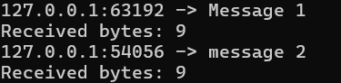

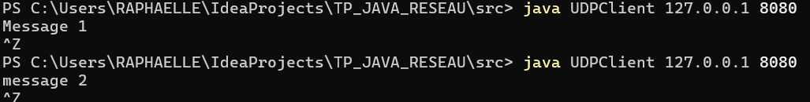

**Step 11**

The client prefixes the typed line with its sequence number and sends 0:hello. The server extracts the number and the text, and displays seq=0 -> hello, with the client’s address and port

The server receives them in order (seq=0, seq=1, seq=2), so no [MISSING] or [OUT OF ORDER] message appears. This is expected on localhost, since the datagrams do not cross a real network.

**Step 12**

Each message is sent with its sequence number, and the client waits for the matching acknowledgment (ACK:0, ACK:1, ACK:2). All messages are acknowledged at the first attempt, so no retransmission is needed.

After receiving message n, the server sends ACK:n back to the address and port of the sender (127.0.0.1:53416).

No acknowledgment is received for message 3, so after each 500 ms timeout the client sends the message again. After 5 unsuccessful attempts, it gives up and displays an error. With UDP, the client is not informed that the server is down. It only notices that no acknowledgment comes back.

**Step 13**
a) On localhost

The server received all of them (loss rate = 0 %). Both programs run on the same machine, so the datagrams never cross a real network, and the server reads them fast enough to keep its receive buffer from filling up.

b)  between two machines of the room:

Machine A:

Machine B:

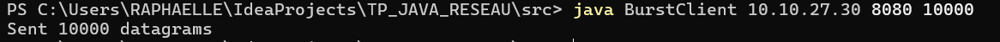

We tried to run the server on one laptop (IP address 10.10.27.30, ENSEA Wi-Fi network) and the burst client on the other laptop, using the server’s IP address instead of localhost. We checked that the correct IP address was used and that no firewall was blocking the port, yet no datagram was received by the server, so the loss rate could not be measured

c) On localhost again, with a server that waits a few milliseconds (Thread.sleep) after each datagram
received:

We restarted the server with a 1 ms pause (Thread.sleep(1)) after each received datagram, then sent the same burst of 10 000 datagrams. This time the server received only 6 690 of them, a loss rate of 33.10 %

In case a), the server reads fast enough, so the buffer never fills up. In case c), the server reads more slowly than the client sends, so the buffer fills up and the extra datagrams are dropped.

**Step 14**

**Step 16**
We created a Java class called MulticastReceiver to receive UDP multicast messages.

We got into the group : "Joined multicast group"

**Step 17**
a) the three receptors receive the message 

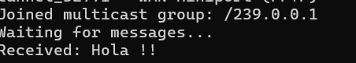
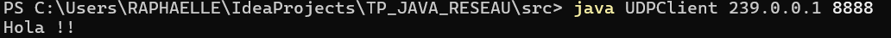

