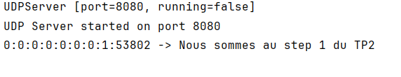
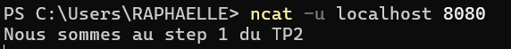

# TP_Java_Reseaux
Report on the Network Java lab

**Step 1**
The objective of this step is to create a UDP server in Java that receives datagrams from clients.

The server listens on a specified port and displays each received message along with the client's IP address and port number.

The project contains two Java classes: UDPServer.java and Main.java

The UDPServer.java class implements the UDP server. It contains:

- Two constructors:
  - A constructor that accepts a port number.
  - A default constructor that uses port 8080.
- A `launch()` method that starts the server and receives UDP datagrams in an infinite loop.
- A 1024-byte buffer to receive incoming messages.
- UTF-8 decoding to convert received bytes into strings.
- The client's IP address and port retrieval.
- A `toString()` method that describes the server's state.

The Main.java class contains the `main()` method which starts the server.
If a port number is provided as an argument, the server uses that port. Otherwise, the default port 8080 is used.

PowerShell is the "client" and we are using the ncat programm : 

