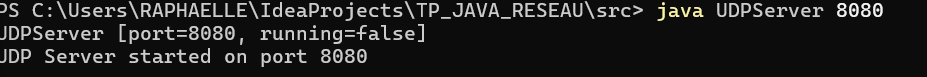

# TP_Java_Reseaux
Report on the Network Java lab

**Step 1**
The objective of this step is to create a UDP server in Java that receives datagrams from clients.

The server listens on a specified port and displays each received message along with the client's IP address and port number.

The project contains one Java classes: UDPServer.java

The UDPServer.java class implements the UDP server. It contains 2 constructors etc 

The default port is 8080. 

PowerShell is the "client" 

We can notice we can connect
**Step 2**
We are using the ncat programm in an other powershell 

We can see that the 2 servers are trying to use the same port (8080) at the same time but it is already being used by the first one 
